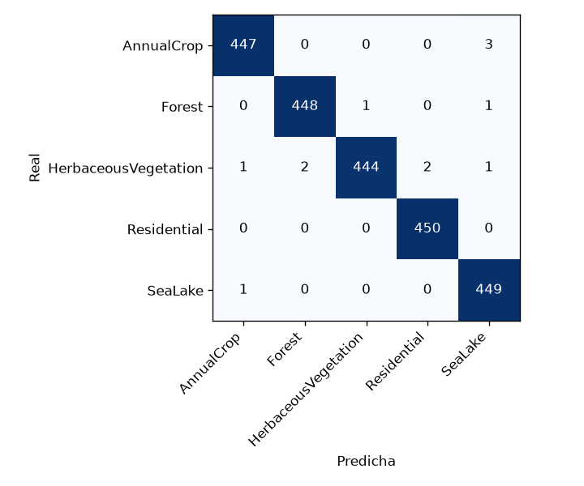
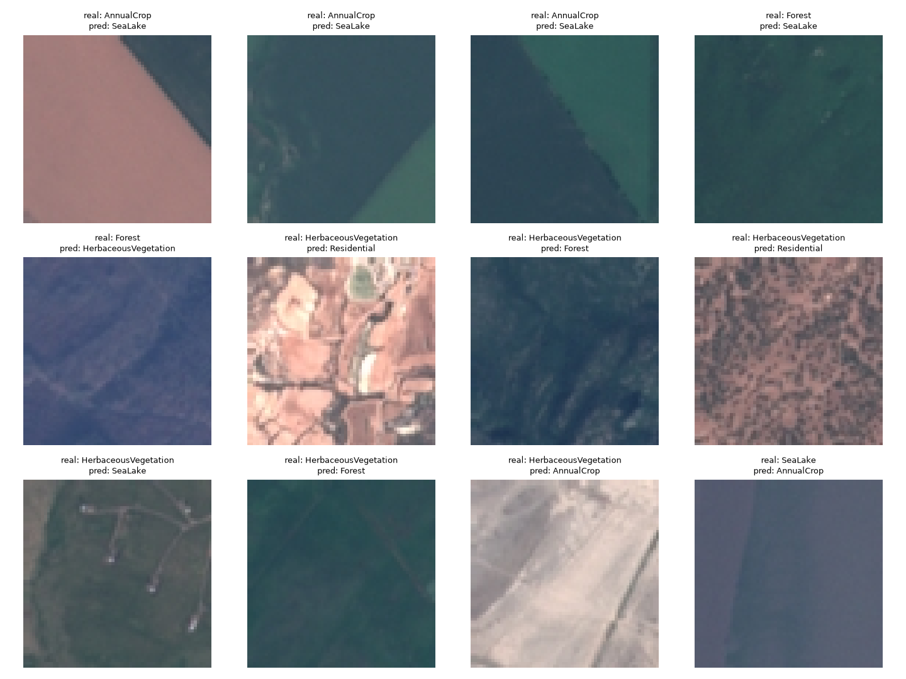

# Clasificador de cobertura del suelo con imágenes satelitales

[](https://github.com/DHat3r/landuse-classifier/actions/workflows/ci.yml)

> Clasifica parches satelitales de 64 × 64 píxeles en cinco tipos de cobertura del suelo. Sirve para practicar un flujo completo de ML: datos, entrenamiento, evaluación y despliegue en una API con Docker.

<!--  -->

## Demo

- Enlace en vivo: no hay despliegue público. Se ejecuta en local (ver más abajo).
- Documentación de la API (Swagger): `http://localhost:8000/docs` con el contenedor en marcha.

## Qué hace

Clasifica imágenes del dataset EuroSAT, tomadas por el satélite Sentinel-2 de Copernicus. Usa 5 clases: `AnnualCrop`, `Forest`, `HerbaceousVegetation`, `Residential` y `SeaLake`. El dataset tiene 3000 imágenes por clase, 15 000 en total, en RGB de 64 × 64 píxeles.

La web muestra la imagen tal como la ve el modelo (64 × 64) y una leyenda con la probabilidad de cada clase.

## Stack

| Capa | Tecnología |
|------|------------|
| Backend | Python 3.12, PyTorch + torchvision (CPU), FastAPI |
| Frontend | HTML, CSS y JavaScript (canvas), sin frameworks |
| Base de datos | No aplica |
| Infraestructura | Docker, Docker Compose, GitHub Actions |

## Cómo ejecutarlo

La API necesita el modelo entrenado en `models/best.pt`. Los archivos `.pt` no se suben al repositorio por su tamaño. Si el modelo no existe, la web carga, pero `POST /predict` responde 503. Para generarlo, ver la sección "Entrenar el modelo".

```bash
git clone https://github.com/DHat3r/landuse-classifier.git
cd landuse-classifier
docker compose up api
```

Luego abre `http://localhost:8000`. Si ese puerto está ocupado, usa otro: `API_PORT=8080 docker compose up api`.

### Entrenar el modelo

El dataset no está en el repositorio.

1. Descarga EuroSAT (versión RGB).
2. Deja una subcarpeta por clase, con solo estas 5: `AnnualCrop`, `Forest`, `HerbaceousVegetation`, `Residential` y `SeaLake`.
3. Ejecuta:

```bash
DATA_DIR=/ruta/al/dataset docker compose --profile train run --rm train
```

El comando entrena una ResNet18 durante 5 épocas con `lr` 1e-4. Guarda el modelo en `models/best.pt` y las métricas en `reports/metrics_best.json`. Las carpetas `models/` y `reports/` deben ser escribibles por el contenedor (ver la nota en `docker-compose.yml`).

### Evaluar el modelo

Evalúa `models/best.pt` sobre el test set de 2250 imágenes:

```bash
DATA_DIR=/ruta/al/dataset docker compose --profile train run --rm train \
  python -m landuse.evaluate --model /app/models/best.pt --data-dir /data --reports-dir /app/reports
```

Dentro del contenedor, `/data` es la carpeta `DATA_DIR` del host. La evaluación escribe en `reports/` el archivo `classification_report.json`, la matriz de confusión (`confusion_matrix.png`) y una cuadrícula con ejemplos mal clasificados (`misclassified.png`).

## API

| Método | Ruta | Descripción |
|--------|------|-------------|
| GET | `/health` | Estado de la API y si el modelo ya está cargado. |
| POST | `/predict` | Clasifica una imagen. Formulario multipart con el campo `file`, JPEG o PNG, máximo 5 MB. |
| GET | `/` | Web de demostración. |

Ejemplo con `curl`:

```bash
curl -F "file=@ejemplo.png;type=image/png" http://localhost:8000/predict
```

Respuesta (recortada: aparecen las 5 clases):

```json
{
  "prediction": "Residential",
  "confidence": 0.9999,
  "probabilities": {
    "Residential": 0.9999,
    ...
  }
}
```

Errores:

| Código | Causa |
|--------|-------|
| 415 | El tipo de archivo no es JPEG ni PNG. |
| 413 | La imagen supera los 5 MB. |
| 400 | El archivo está vacío o no es una imagen válida. |
| 503 | No hay modelo en `models/best.pt`. |

## Tests

Hay 17 tests con pytest:

- `tests/test_data.py` (6): partición sin fuga, reproducibilidad y estratificación.
- `tests/test_model.py` (4): forma de salida de los modelos y guardado y carga de checkpoints. Tres casos son parametrizados.
- `tests/test_api.py` (7): respuestas de la API y errores.

Local, igual que en CI:

```bash
pip install torch torchvision --index-url https://download.pytorch.org/whl/cpu
pip install -r requirements-dev.txt
python -m pytest -q
```

Dentro de Docker: la imagen no incluye `tests/` ni `requirements-dev.txt` (por `.dockerignore` y el Dockerfile), así que hay que montarlos:

```bash
docker compose run --rm \
  -v "$(pwd)/tests:/app/tests:ro" \
  -v "$(pwd)/requirements-dev.txt:/app/requirements-dev.txt:ro" \
  api sh -c "pip install -q -r requirements-dev.txt && python -m pytest -q"
```

En Git Bash (Windows), antepón `MSYS_NO_PATHCONV=1` y usa `$(pwd -W)` en lugar de `$(pwd)` para que las rutas de los volúmenes no se conviertan mal.

GitHub Actions ejecuta los tests en cada push y en cada pull request dirigido a `main` (`.github/workflows/ci.yml`).

## Arquitectura

1. El navegador carga la web desde `GET /`.
2. Al subir una imagen, la web envía el archivo a `POST /predict`.
3. La API valida el tipo y el tamaño, decodifica la imagen con Pillow y la redimensiona a 64 × 64.
4. La ResNet18 devuelve una puntuación por clase. Un softmax la convierte en probabilidades.
5. La API responde la clase con mayor probabilidad y las probabilidades de todas las clases.

Estructura del proyecto:

```text
.
├── src/landuse/
│   ├── data.py        # Listado de imágenes, partición y Dataset
│   ├── model.py       # Arquitecturas y guardado/carga de checkpoints
│   ├── train.py       # Entrenamiento
│   ├── evaluate.py    # Evaluación sobre el test set
│   └── api.py         # API FastAPI
├── web/index.html     # Web de demostración
├── tests/             # Tests con pytest
├── docs/              # Imágenes de los resultados
├── models/            # Modelos entrenados (no se suben al repositorio)
├── reports/           # Métricas y reportes de evaluación
├── Dockerfile
└── docker-compose.yml
```

## Decisiones técnicas

- **Por qué ResNet18 con transfer learning y no una CNN propia:** la ResNet18 preentrenada en ImageNet llega a 99,47 % en test, frente a 96,84 % de la mejor CNN propia. Solo se reemplaza la última capa para dar 5 clases.
- **Por qué partición por rutas de archivo:** cada archivo cae en un solo conjunto antes de cargar ninguna imagen. Así no hay fuga de datos, y con la semilla fija la partición es reproducible.
- **Por qué elegir el modelo por validación:** el test set se usa una sola vez, al final, con el checkpoint de la mejor época según validación.
- **Por qué `lr` 1e-4:** para hacer fine-tuning real de los pesos de ImageNet (ver "Lo aprendido").
- **Por qué augmentation con volteos y rotaciones de 90°:** una imagen satelital no tiene "arriba", así que estas transformaciones son válidas.
- **Por qué PyTorch desde el índice CPU en el Dockerfile:** la versión por defecto trae CUDA, con cientos de MB extra que la inferencia en CPU no usa.
- **Por qué usuario no root y volúmenes de solo lectura:** si la app se compromete, no tiene permisos de root dentro del contenedor. La API solo lee `models/`, y el dataset se monta en solo lectura.

## Resultados

La partición es estratificada por clase, 70/15/15, con semilla 42: 10 500 imágenes para entrenar, 2250 para validación y 2250 para test.

| Modelo | Épocas | lr | Val | Test | Parámetros | Tiempo CPU |
|--------|--------|----|-----|------|------------|------------|
| CNN base | 10 | 1e-3 | 96,00 % | 96,04 % | 2,19 M | 358 s |
| CNN + dropout 0,5 | 10 | 1e-3 | 96,49 % | 96,84 % | 2,19 M | 373 s |
| ResNet18 preentrenada | 5 | 1e-3 | 92,40 % | 92,22 % | 11,18 M | 352 s |
| ResNet18 preentrenada (modelo final) | 5 | 1e-4 | 99,51 % | 99,47 % | 11,18 M | 325 s |

### Lo aprendido

- Con `lr` 1e-3, la ResNet18 preentrenada oscilaba en validación entre 76 % y 92 %. Un paso grande destruye los pesos de ImageNet. Con 1e-4 hace fine-tuning real y llega a 99,5 % en un tiempo similar.
- El dropout subió la exactitud (accuracy) de la CNN propia en 0,5 puntos en validación y 0,8 en test.
- Se guarda el checkpoint de la mejor época por validación, no el de la última. En la ResNet18 la mejor fue la época 4 (99,51 %). La época 5 bajó a 99,20 %.

### Análisis de errores

El modelo final falla 12 de 2250 imágenes del test set.



| Clase | Precision | Recall | F1 |
|-------|-----------|--------|----|
| AnnualCrop | 99,6 | 99,3 | 99,4 |
| Forest | 99,6 | 99,6 | 99,6 |
| HerbaceousVegetation | 99,8 | 98,7 | 99,2 |
| Residential | 99,6 | 100 | 99,8 |
| SeaLake | 98,9 | 99,8 | 99,3 |

- `HerbaceousVegetation` es la clase más difícil: 6 errores. Se confunde con bosque (2), zona residencial (2), cultivo (1) y agua (1).
- 3 cultivos oscuros y uniformes se predicen como agua.



## Limitaciones

- Solo usa 5 de las 10 clases de EuroSAT.
- Usa imágenes RGB de 64 × 64. No aprovecha las 13 bandas espectrales.
- La confianza es la salida del softmax y no está calibrada. Ante una imagen fuera de la distribución (no satelital, u otra región o sensor), el modelo reparte el 100 % entre sus 5 clases y puede dar confianza alta a una clase equivocada.

## Qué mejoraría

- Calibrar la confianza con *temperature scaling* sobre el conjunto de validación, para que un 90 % signifique de verdad acertar 9 de cada 10 veces.
- Detectar imágenes fuera de distribución y responder "no reconocida" en vez de forzar una de las 5 clases.
- Entrenar con las 10 clases de EuroSAT y con las 13 bandas espectrales de Sentinel-2, no solo RGB.
- Publicar una demo en línea con un modelo más ligero para CPU (por ejemplo, exportado a ONNX).

## Créditos

- Dataset: EuroSAT. Helber et al., 2019, "EuroSAT: A Novel Dataset and Deep Learning Benchmark for Land Use and Land Cover Classification", IEEE JSTARS. Imágenes de Copernicus Sentinel-2.

## Autor

Leandro Norambuena · [GitHub](https://github.com/DHat3r)
